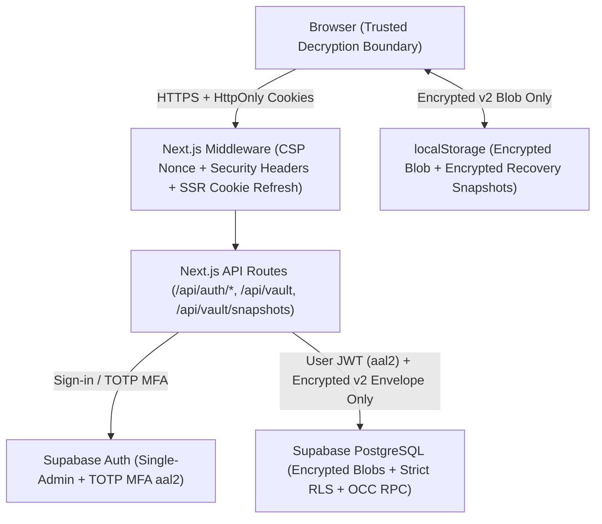

# Architecture — NMark Pass Vault v2

## 1. High-Level System Architecture



### Dual-Mode Operation
- **Cloud Synced Mode** (when `NEXT_PUBLIC_SUPABASE_URL` and `NEXT_PUBLIC_SUPABASE_ANON_KEY` are set):
  1. Single-admin sign-in (`/api/auth/session`)
  2. Mandatory TOTP MFA verification (`/api/auth/mfa` → `aal2`)
  3. Fetch encrypted envelope (`/api/vault`) and cache locally
  4. Local Master Password unlock (`lib/crypto.ts`)
  5. Writes persist locally first, then sync encrypted envelope to `/api/vault` with `expectedRevision`
- **Local-Only Mode** (when Supabase env vars are unset):
  - Skips cloud auth/MFA gates and runs completely locally against `localStorage['secure_vault_blob']` with full v2 cryptography, serialized concurrency, multi-tab sync, verified backups, recovery snapshots, and Client Hub deep links.

---

## 2. Encrypted Envelope Versioning & Migration

### Version 1 (Legacy — Read-Only Compatibility)
```json
{
  "version": 1,
  "kdf": { "algorithm": "argon2id", "memory": 65536, "iterations": 3, "parallelism": 1, "salt": "<base64>" },
  "encryption": { "algorithm": "AES-256-GCM", "iv": "<base64>" },
  "ciphertext": "<base64>"
}
```

### Version 2 (Current — Authenticated Metadata + Concurrency Revision)
```json
{
  "version": 2,
  "revision": 4,
  "updatedAt": "2026-11-23T09:00:00.000Z",
  "updatedByDevice": "9b1deb4d-3b7d-4bad-9bdd-2b0d7b3dcb6d",
  "kdf": { "algorithm": "argon2id", "memory": 65536, "iterations": 3, "parallelism": 1, "salt": "<base64>" },
  "encryption": { "algorithm": "AES-256-GCM", "iv": "<base64>", "aadVersion": 1 },
  "ciphertext": "<base64>"
}
```

### Migration Strategy (v1 → v2)
- Unlocking an existing v1 vault automatically:
  1. Decrypts using v1 parameters (no AAD) and normalizes missing v2 item/settings fields (`tags`, `lockOnBlur`, `autoHidePasswordSeconds`).
  2. Stores the original encrypted v1 blob in `localStorage['secure_vault_recovery_snapshots']` (`reason: 'v1_migration'`).
  3. Re-encrypts into Format v2 (`revision: 1`, `aadVersion: 1`) and persists cleanly.
- Importing a v1 backup runs through the exact same verified-decryption + upgrade path without ever overwriting an existing vault on error.

---

## 3. Concurrency & Conflict Resolution Protocol

### Serialized Local Write Queue (`store/vaultStore.ts`)
All mutations (`addVaultItem`, `updateVaultItem`, `deleteVaultItem`, `saveSettings`, `retrySave`) pass through a single FIFO promise chain (`enqueueSerializedWrite`). Each mutation reads the latest Zustand state when its turn starts, increments `revision = expectedRevision + 1`, encrypts with a fresh IV, and writes atomically.

### Optimistic Concurrency Control (OCC)
- **Multi-Tab (`localStorage`):** Before `persistBlob()` writes, it checks that the stored blob's revision equals `expectedRevision`. If another tab saved a newer revision, `VaultRevisionConflictError` is thrown and `ConflictModal` opens without overwriting the sibling tab's data. `storage` events and `BroadcastChannel` also proactively notify open tabs.
- **Multi-Device (PostgreSQL):** `PUT /api/vault` invokes `public.upsert_encrypted_vault(...)` which executes `SELECT ... FOR UPDATE` on `public.vaults`. If `existing.revision <> p_expected_revision`, the RPC returns `status: 'CONFLICT'` with the remote encrypted envelope, and the API responds with HTTP `409 Conflict`.
- **Safe Recovery (`ConflictModal`):** Users can export a local encrypted backup first, then choose **Load Newer Revision** (snapshots local encrypted blob first) or **Keep My Local Changes** (snapshots remote encrypted blob first, then advances revision above remote).

---

## 4. Database Schema (`supabase/migrations/001_init_vault.sql`)

| Table | Purpose | RLS Policy |
|---|---|---|
| `public.vaults` | Single encrypted v2 envelope per user (`user_id` PK, KDF/IV/AAD columns, `ciphertext`, `revision`) | `FORCE RLS`: `auth.uid() = user_id AND (auth.jwt() ->> 'aal') = 'aal2'` |
| `public.vault_snapshots` | Encrypted recovery snapshots (`envelope jsonb`, `reason`, `revision`) | `FORCE RLS`: `auth.uid() = user_id AND (auth.jwt() ->> 'aal') = 'aal2'` |
| `public.vault_audit_log` | Metadata-only audit log (`event_type`, `revision`, `device_id`, `created_at` — zero secrets) | `FORCE RLS`: append/read by owner + `aal2` |

All privileges on all tables and functions are explicitly revoked from `anon` and `public`.

---

## 5. Directory Structure

```text
app/
  api/
    auth/{session,mfa,signout}/route.ts   # Single-admin auth & TOTP MFA
    vault/route.ts                        # Encrypted vault sync (GET/PUT + 409 OCC)
    vault/snapshots/route.ts              # Encrypted cloud recovery snapshots
    health/route.ts                       # Safe service health check
  item/[id]/page.tsx                      # Client Hub deep-link route
  layout.tsx, page.tsx, robots.ts
components/
  VaultApp.tsx                            # Security gate orchestrator
  auth/{CloudSignInPage,MfaGatePage,SetupPage,UnlockPage}.tsx
  vault/{VaultLayout,Sidebar,ItemList,EntryModal,PasswordGenerator,SettingsPanel,ConflictModal}.tsx
hooks/
  useInactivityLock.ts                    # Wall-clock auto-lock + multi-tab sync
  useClipboard.ts                         # Safe best-effort clipboard clearing
lib/
  crypto.ts                               # Argon2id + AES-256-GCM (v1 & v2 AAD)
  vaultService.ts                         # Local persistence, OCC, verified import, snapshots
  cloudSync.ts                            # Encrypted /api/vault client
  tabSync.ts                              # BroadcastChannel cross-tab sync
  urlSafety.ts                            # Protocol/redirect/item-ID validators + CSPRNG UUID
  env.ts                                  # Public vs server-only env + fail-closed allowlist
  auth/guard.ts                           # Server-side Auth + Admin + aal2 guard
  security/{csp,csrf,rateLimit}.ts        # CSP, CSRF origin check, sliding-window limiter
  supabase/server.ts                      # @supabase/ssr server client (HttpOnly cookies)
store/vaultStore.ts                       # In-memory Zustand store + serialized write queue
supabase/migrations/001_init_vault.sql    # PostgreSQL schema, RLS, OCC RPC
tests/                                    # Vitest unit, hook, component & API route tests
```
